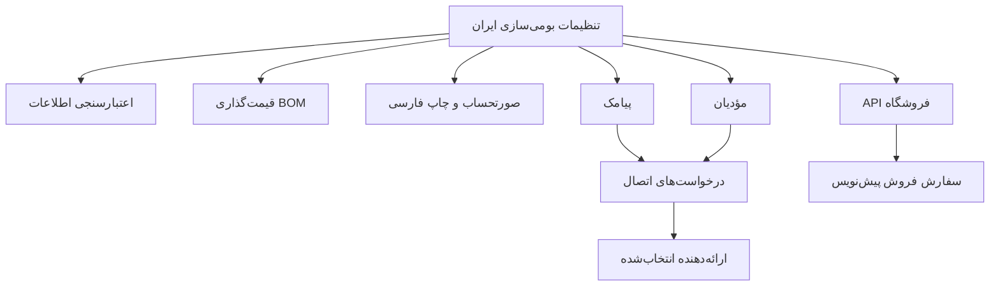
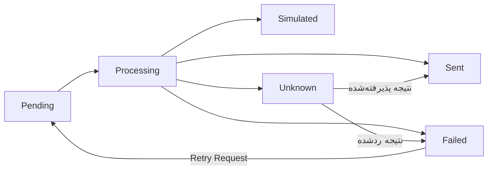

# راهنمای کاربری و نگهداری Iran Localization

این راهنما توضیح می‌دهد افزونه چه کاری انجام می‌دهد، از کجا تنظیم می‌شود و هر عملیات چه نتیجه‌ای دارد.
مبنای آن کد فعلی نسخهٔ `0.1.0` است. تاریخ تهیه: ۱۴ مهر ۱۴۰۵، برابر با ۶ اکتبر ۲۰۲۶.

## فهرست مطالب

1. [نقشهٔ کلی سیستم](#overview)
2. [شروع کار و اصطلاحات](#start)
3. [تنظیمات و کلیدهای ماژول‌ها](#settings)
4. [اطلاعات ایران و اعتبارسنجی](#validation)
5. [قیمت‌گذاری خودکار محصولات](#pricing)
6. [صورتحساب و چاپ فارسی](#invoice)
7. [پیامک](#sms)
8. [سامانهٔ مؤدیان](#taxpayer)
9. [وضعیت درخواست‌ها و تعویض ارائه‌دهنده](#requests)
10. [API فروشگاه](#commerce)
11. [نصب، ارتقا و نگهداری](#maintenance)
12. [عیب‌یابی](#troubleshooting)
13. [ساختار کد و توسعه](#development)
14. [وضعیت فعلی و محدودیت‌ها](#status)

<a id="overview"></a>

## ۱. نقشهٔ کلی سیستم

پلتفرم شما سه لایه دارد:

| لایه | کار اصلی |
|---|---|
| Frappe | فرم‌ها، کاربران، نقش‌ها، مجوزها، دیتابیس و API |
| ERPNext | حسابداری، خرید، فروش، موجودی، تولید و اسناد کسب‌وکار |
| Iran Localization | اطلاعات ایران، اعتبارسنجی، قیمت‌گذاری BOM، چاپ فارسی و اتصال‌ها |

افزونه از فرم‌ها و رویدادهای استاندارد سیستم استفاده می‌کند؛ تغییرات آن در پوشهٔ `iran_localization` نگهداری می‌شوند.
وجود این افزونه به معنی پیاده‌سازی مجدد همهٔ امکانات ERP یا نصب تمام نرم‌افزارهای جانبی مثل HRMS و Helpdesk نیست.



هر ماژول کلید فعال‌سازی خودش را دارد. خاموش بودن پیامک یا مؤدیان مانع ثبت عادی فاکتور نیست.
قیمت‌گذاری، برخلاف اتصال‌های خارجی، هنگام ذخیرهٔ قیمت مادهٔ اولیه اجرا می‌شود؛ خطای آن می‌تواند همان ذخیره را متوقف کند.

<a id="start"></a>

## ۲. شروع کار و اصطلاحات

در محیط توسعهٔ فعلی:

- پوشهٔ Bench: `/workspace/development/frappe-bench`
- پوشهٔ افزونه: `/workspace/development/frappe-bench/apps/iran_localization`
- سایت تست: `erp.localhost`
- آدرس توسعهٔ معرفی‌شده برای این محیط: `http://localhost:8000`، در صورت اجرای stack توسعه.

برای راه‌اندازی محیط توسعه از پوشهٔ Bench:

```sh
cd /workspace/development/frappe-bench
bench start
```

برای تنظیم افزونه با کاربری دارای نقش `System Manager` وارد Desk شوید.
Workspace «Iran Localization» را باز کنید و سپس «Iran Localization Settings» را انتخاب کنید.
اگر Workspace در منو دیده نمی‌شود، نام فرم تنظیمات را در جست‌وجوی Desk وارد کنید.
نام انگلیسی دکمه‌ها در این راهنما همان نام استفاده‌شده در کد است؛ ترجمهٔ رابط ممکن است متفاوت باشد.

| اصطلاح | معنی عملی |
|---|---|
| DocType | نوع یک فرم یا سند، مثل Customer یا Sales Invoice |
| Single DocType | فرم تنظیماتی که برای هر سایت یک مجموعه مقدار دارد |
| Item | کالا، مادهٔ اولیه، نیمه‌ساخته یا خدمت |
| Price List | فهرست قیمت؛ نام، ارز و کاربرد خرید/فروش دارد |
| Item Price | قیمت یک کالا در یک Price List با واحد و شرایط مشخص |
| BOM | فرمول ساخت؛ مشخص می‌کند چه موادی برای چه مقدار خروجی مصرف می‌شوند |
| Draft | سند پیش‌نویس؛ هنوز تأیید نهایی نشده است |
| Submit | تأیید نهایی سند در گردش کار ERPNext |
| UOM | واحد اندازه‌گیری، مثل عدد یا کیلوگرم |
| Provider | ارائه‌دهندهٔ سرویس بیرونی، مانند سرویس پیامک |
| Adapter | کدی که قرارداد داخلی افزونه را به API ارائه‌دهنده تبدیل می‌کند |
| Mock | ارائه‌دهندهٔ آزمایشی که ارسال واقعی انجام نمی‌دهد |

<a id="settings"></a>

## ۳. تنظیمات و کلیدهای ماژول‌ها

بعد از تغییر تنظیمات، `Save` کنید. تغییر ذخیره‌نشده مبنای کار سمت سرور نیست.
در نصب جدید کلیدهای عملیاتی زیر خاموش‌اند؛ در ارتقای سایت قدیمی، مقادیر ذخیره‌شده حفظ می‌شوند.

| گزینه | نام فنی | اثر روشن بودن |
|---|---|---|
| اعتبارسنجی اطلاعات ایران | `enable_core_validation` | کنترل Company، Customer و Supplier هنگام اعتبارسنجی سند |
| بررسی رقم کنترل | `enable_strict_national_id` | بررسی قوی‌تر شناسه، وقتی اعتبارسنجی هسته روشن است |
| اتوماسیون قیمت‌گذاری | `enable_pricing_automation` | واکنش به ذخیرهٔ Item Price در لیست مواد اولیه |
| ماژول فاکتور رسمی | `enable_official_invoice_module` | استفاده از گزینهٔ صورتحساب رسمی و دکمهٔ چاپ فارسی |
| پیامک | `enable_sms` | امکان ایجاد و ارسال درخواست پیامک |
| اتصال مؤدیان | `enable_taxpayer_system` | امکان صف‌کردن و ارسال جداگانهٔ فاکتور |
| API فروشگاه | `enable_commerce_api` | دسترسی به کاتالوگ، محاسبهٔ سفارش و ایجاد سفارش API |

کلیدهای قدیمی `enable_iran_validations` و `enable_official_invoice` برای سازگاری با ارتقا باقی مانده‌اند و مخفی‌اند.
برای کنترل رفتار فعلی از کلیدهای جدول بالا استفاده کنید.

ساختار فرم تنظیمات داخل کد افزونه تعریف می‌شود، اما مقدار انتخابی شما داخل دیتابیس همان سایت است.
مقدار صفر، انتخاب خالی و نام Price List سایت نباید با defaults جایگزین شوند.
رمزهای API در فیلدهای Password ذخیره می‌شوند و در payload درخواست‌ها قرار نمی‌گیرند.

<a id="validation"></a>

## ۴. اطلاعات ایران و اعتبارسنجی

در فرم‌های Company، Customer و Supplier این فیلدها وجود دارند:

| فیلد | نام فنی |
|---|---|
| شناسه ملی / کد ملی | `iran_national_id` |
| کد اقتصادی | `iran_economic_code` |
| شماره ثبت | `iran_registration_number` |
| کد پستی | `iran_postal_code` |

برای فعال‌سازی، گزینهٔ اعتبارسنجی اطلاعات ایران را روشن و ذخیره کنید.
پس از آن، در همین چهار فیلد ارقام فارسی و عربی به ارقام انگلیسی تبدیل و فاصلهٔ ابتدا/انتها حذف می‌شود.
این تبدیل، فاصله یا خط تیرهٔ وسط شناسه را حذف نمی‌کند.

کنترل‌های فعلی:

- کد پستیِ واردشده باید دقیقاً ۱۰ رقم باشد.
- شناسهٔ واردشده باید ۱۰ یا ۱۱ رقم باشد.
- با فعال‌بودن رقم کنترل، مقدار ۱۰رقمی با الگوریتم کد ملی و مقدار ۱۱رقمی با الگوریتم شناسهٔ حقوقی بررسی می‌شود.
- کد اقتصادی و شماره ثبت در این نسخه فقط تبدیل ارقام می‌شوند؛ کنترل قالب یا رقم کنترل اختصاصی ندارند.
- فیلد خالی از نظر این ماژول مجاز است.

مثال: `۱۲۳۴۵۶۷۸۹۰` در فیلد کد پستی به `1234567890` تبدیل می‌شود، اما `12345` خطا می‌گیرد.
وقتی اعتبارسنجی هسته خاموش باشد، این ماژول تبدیل ارقام و کنترل قالب را اجرا نمی‌کند.

کنترل رقم به معنی استعلام هویت از ثبت احوال یا ثبت شرکت‌ها نیست؛ صحت ریاضی شناسه را بررسی می‌کند.

<a id="pricing"></a>

## ۵. قیمت‌گذاری خودکار محصولات

### آماده‌سازی

1. برای مواد اولیه یک Price List فعال با کاربرد `Buying` بسازید.
2. برای محصولات یک Price List فعال با کاربرد `Selling` بسازید.
3. برای مواد اولیه، Item Price در لیست خرید ثبت کنید.
4. BOM محصولات را با مقدار خروجی، واحد و مواد مصرفی درست بسازید و Submit کنید.
5. برای هزینه‌گذاری از قیمت مواد، روش BOM را `Price List` و لیست خرید آن را مناسب انتخاب کنید.
6. برای زیرمونتاژ، BOM مرتبط و تنظیم استفاده از هزینهٔ BOM زیرمونتاژ را بررسی کنید.
7. BOM مربوط به قیمت فروش هر محصول را `Default` و `Active` قرار دهید.
8. در تنظیمات افزونه لیست‌ها، سربار و درصد سود را انتخاب و قیمت‌گذاری را روشن کنید.

دو لیست خرید و فروش باید متفاوت باشند. نام فارسی یا انگلیسی آن‌ها اختیاری است.
انتخاب لیست در تنظیمات افزونه، روش هزینه‌گذاری و لیست انتخاب‌شدهٔ داخل BOM را خودکار عوض نمی‌کند.
این تنظیمات باید با هم هماهنگ باشند.

| تنظیم | نام فنی | نمونهٔ فرضی |
|---|---|---|
| لیست مواد اولیه | `raw_material_price_list` | خرید مواد |
| لیست فروش محصولات | `selling_price_list` | فروش محصولات |
| سربار تولید | `manufacturing_overhead_percent` | ۱۰ درصد |
| افزایش قیمت بابت سود | `profit_markup_percent` | ۲۰ درصد |

### چه چیزی زنجیره را شروع می‌کند؟

ذخیرهٔ Item Price در لیست مواد اولیهٔ تنظیم‌شده، زنجیره را شروع می‌کند؛ فقط تغییر عدد قیمت شرط نیست.
ذخیرهٔ قیمت در لیستی دیگر، این ماژول را اجرا نمی‌کند.
تغییر تنظیمات سربار/سود یا تغییر BOM به‌تنهایی محرک این hook نیست؛ برای اجرای مجدد این مسیر، قیمت مادهٔ مرتبط را ذخیره کنید.
در این نسخه hook جداگانه‌ای برای حذف Item Price تعریف نشده است.


افزونه ابتدا وابستگی‌ها را پیدا می‌کند و ترتیب محاسبه را مشخص می‌کند.
بنابراین اگر محصول نهایی دو نیمه‌ساختهٔ مشترک دارد، هر دو نیمه‌ساخته پیش از محصول نهایی محاسبه می‌شوند.
BOMهای Draft، لغوشده یا غیرفعال وارد این محاسبه نمی‌شوند.
هزینهٔ BOMهای فعالِ جایگزین نیز ممکن است به‌روزرسانی شود، ولی فقط BOM پیش‌فرض قیمت فروش را منتشر می‌کند.

### فرمول قیمت

```text
هزینه واحد = هزینه کل BOM ÷ مقدار خروجی BOM
قیمت فروش = هزینه واحد × (۱ + سربار ÷ ۱۰۰) × (۱ + سود ÷ ۱۰۰)
```

مثال فرضی، با همهٔ مبالغ در یک ارز:

| مرحله | مقدار |
|---|---|
| هزینهٔ کل BOM | ۱٬۰۰۰٬۰۰۰ |
| مقدار خروجی BOM | ۲ عدد |
| هزینهٔ هر واحد | ۵۰۰٬۰۰۰ |
| پس از سربار ۱۰٪ | ۵۵۰٬۰۰۰ |
| پس از افزایش ۲۰٪ بابت سود | ۶۶۰٬۰۰۰ |

`profit_markup_percent` درصد افزایش روی هزینهٔ پس از سربار است؛ درصد حاشیهٔ سود از مبلغ فروش نیست.
سربار و سود ضربی اعمال می‌شوند و جمع سادهٔ آن‌ها مبنای قیمت نیست.
اگر ارز BOM با ارز لیست فروش فرق کند، تبدیل با نرخ ERPNext انجام می‌شود؛ نبود نرخ معتبر خطا می‌دهد.

### کدام Item Price عوض می‌شود؟

افزونه در لیست فروش، قیمت همان کالا و UOM را پیدا می‌کند و میان قیمت‌های عمومی معتبر امروز، جدیدترین تاریخ شروع را ترجیح می‌دهد.
قیمت اختصاصی مشتری، تأمین‌کننده یا بچ، قیمت آینده، قیمت منقضی و بسته‌بندی بیش از یک واحد انتخاب نمی‌شوند.
اگر قیمت مناسب موجود نباشد، یک Item Price ساخته می‌شود.
اگر دو قیمت قابل انتخاب با تاریخ شروع یکسان وجود داشته باشند، افزونه خطا می‌دهد تا قیمت مبهم بازنویسی نشود.

### محدودیت‌هایی که روی نتیجه اثر دارند

- منبع هزینه همچنان موتور BOM در ERPNext است؛ لیست خرید نادرست یا روش Valuation Rate می‌تواند نتیجه‌ای متفاوت بدهد.
- ERPNext در Update Cost نرخ مواد غیرانبارشدنی را مثل مواد انبارشدنی دوباره دریافت نمی‌کند.
- چرخهٔ وابستگی BOM پیش از اعمال این زنجیره شناسایی و متوقف می‌شود.
- این ماژول قیمت پایهٔ فروش را تعیین می‌کند؛ مالیات و قواعد تخفیف فروش همچنان در ERPNext محاسبه می‌شوند.

<a id="invoice"></a>

## ۶. صورتحساب و چاپ فارسی

### صدور صورتحساب با مشخصات ایران

1. در Company و Customer، شناسه ملی و کد پستی را تکمیل کنید.
2. کد اقتصادی و شماره ثبت را در صورت نیاز وارد کنید.
3. ماژول فاکتور رسمی را در تنظیمات روشن و ذخیره کنید.
4. Sales Invoice بسازید و گزینهٔ «صورتحساب رسمی ایران» را روشن کنید.
5. کالاها، مالیات‌ها و سایر اطلاعات ERPNext را تکمیل، Save و در مرحلهٔ مناسب Submit کنید.
6. از دکمهٔ `Persian Invoice` یا صفحهٔ Print، قالب `Iran Official Invoice` را انتخاب کنید.

وقتی گزینهٔ رسمی روی خود فاکتور روشن باشد، وجود شناسه ملی و کد پستی فروشنده و خریدار لازم است.
اگر گزینهٔ رسمی روشن نباشد، این الزام از طرف ماژول صورتحساب اعمال نمی‌شود.
روشن‌کردن گزینهٔ رسمی در حالی که ماژول آن خاموش است، هنگام اعتبارسنجی خطا می‌دهد.

### مشخصات ذخیره‌شده چگونه کار می‌کنند؟

چهار فیلد ثبتی فروشنده و خریدار در فاکتور کپی می‌شوند.
در Saveهای پیش‌نویس و هنگام Submit، اطلاعات به‌روزِ پروندهٔ طرفین مبنای این کپی است.
پس از صدور، تغییر شناسه یا کد پستی مشتری، چهار فیلد کپی‌شدهٔ فاکتور رسمی را عوض نمی‌کند.
این قابلیت snapshot همین چهار فیلد است؛ نام نمایشی طرفین از پروندهٔ فعلی خوانده می‌شود و نشانی‌ها از فیلدهای خود فاکتور چاپ می‌شوند.
در فاکتور بدون گزینهٔ رسمی، اطلاعات ثبتی برای قالب از پروندهٔ فعلی طرفین خوانده می‌شود.

### چاپ چه چیزهایی را نشان می‌دهد؟

- شمارهٔ فاکتور و تاریخ شمسی همراه تاریخ میلادی.
- ارز سند و مشخصات ثبتی طرفین.
- اقلام، واحد، تعداد، نرخ و مبلغ خالص.
- مالیات‌ها و عوارض ثبت‌شده در سند، جمع کل و تعدیل گرد کردن در صورت وجود.
- محل مهر و امضا و علامت پیش‌نویس، لغوشده یا برگشت از فروش در حالت مربوط.

قالب نرخ مالیات ثابت و از پیش تعیین‌شده ندارد؛ محاسبات خود ERPNext را چاپ می‌کند.
عنوان «صورتحساب رسمی» و چاپ PDF به‌تنهایی تأیید مالیاتی یا ارسال به مؤدیان نیست.
قالب، تاریخ نمایش را شمسی می‌کند؛ تاریخ ذخیره‌شدهٔ اسناد و تاریخ ورودی API همچنان میلادی است.

<a id="sms"></a>

## ۷. پیامک

### آزمایش بدون هزینه و ارسال واقعی

1. در تنظیمات، `sms_provider` را `mock` قرار دهید.
2. `enable_sms` را روشن و Save کنید.
3. دکمهٔ `Queue SMS` را بزنید؛ شمارهٔ همراه و متن را وارد کنید.
4. فرم درخواست ایجادشده را باز کنید؛ وضعیت اولیه `Pending` است.
5. `Send Request` را بزنید و تأیید کنید.
6. وضعیت `Simulated` می‌شود؛ هیچ پیامکی به گیرنده ارسال نمی‌شود.

شماره باید همراه ایران باشد. نمونهٔ `+98 912-345-6789` به `09123456789` تبدیل می‌شود.
ارقام فارسی نیز قابل تبدیل‌اند. متن باید غیرخالی و حداکثر ۲۰۰۰ کاراکتر باشد؛ محدودیت و هزینهٔ سرویس واقعی جداگانه است.
در این نسخه اعلان خودکار پیامک هنگام صدور فاکتور پیاده نشده است؛ ارسال از مسیر درخواست صریح انجام می‌شود.

### استفاده از کاوه‌نگار

| تنظیم | مقدار مورد نیاز |
|---|---|
| `sms_provider` | `kavenegar` |
| `sms_api_key` | کلید حساب سرویس |
| `sms_sender` | شمارهٔ فرستندهٔ مجاز حساب |
| `enable_sms` | روشن |

بعد از ذخیره، درخواست جدید بسازید و نتیجهٔ ارسال را در همان فرم پیگیری کنید.
ارائه‌دهندهٔ فعلی ارسال عمومی SMS را استفاده می‌کند؛ مسیر OTP یا قالب Verify Lookup جداگانه پیاده نشده است.
عملیات پیامک و اتصال‌ها نیازمند نقش `System Manager` است.

<a id="taxpayer"></a>

## ۸. سامانهٔ مؤدیان

این ماژول مسیر مستقلی برای آماده‌سازی و ارسال فاکتور به ارائه‌دهنده دارد.
ثبت یا Submit عادی فاکتور، آن را خودکار ارسال نمی‌کند.

### آزمایش با Mock

1. `taxpayer_provider` را `mock` انتخاب و اتصال مؤدیان را روشن و Save کنید.
2. یک Sales Invoice را از مسیر معمول Submit کنید.
3. در فرم آن، `Queue Taxpayer Invoice` را بزنید.
4. درخواست Pending را باز و `Send Request` را اجرا کنید.
5. نتیجه `Simulated` است؛ صورتحساب به هیچ سامانهٔ خارجی نرفته است.

فاکتور Draft یا Cancelled قابل صف‌کردن نیست.
هنگام ارسال نیز Submitبودن فاکتور دوباره بررسی می‌شود.
تکرار صف‌کردن همان فاکتور با همان محتوای آماده‌شده و ارائه‌دهنده، درخواست تازه نمی‌سازد.
اگر محتوای آماده‌شده یا ارائه‌دهنده عوض شده باشد، شناسهٔ قدیمی خودکار برای ارسال تازه استفاده نمی‌شود.

### اتصال از طریق درگاه HTTP

| تنظیم | کاربرد |
|---|---|
| `taxpayer_provider = http_gateway` | انتخاب adapter درگاه |
| `taxpayer_endpoint` | آدرس HTTPS درگاه سازگار |
| `taxpayer_company` | شرکت مربوط به حساب و حافظهٔ مالیاتی |
| `taxpayer_memory_id` | شناسه حافظهٔ همان شرکت |
| `taxpayer_api_key` | کلید دسترسی درگاه |

برای مسیر واقعی، شرکت فاکتور باید با شرکت انتخاب‌شده یکی باشد.
هر Item فاکتور باید `iran_tax_item_id` داشته باشد و شناسه ملی فروشنده و خریدار باید موجود باشد.
adapter انتخابی مسئول کنترل‌های تکمیلی مورد نیاز سرویس است.

اطلاعات آماده‌شده شامل شناسهٔ فاکتور، تاریخ، ارز، مشخصات طرفین، اقلام، شناسه‌های مالیاتی کالا، مبالغ، مالیات‌ها و اطلاعات برگشت است.
افزونه این اطلاعات را با قرارداد داخلی نسخهٔ ۱ به درگاه می‌دهد.
درگاه باید آن‌ها را به ساختار سرویس مقصد تبدیل کند و امضا، رمزگذاری و الزامات سرویس را پوشش دهد.
صرف قراردادن آدرس API مستقیم سازمان مالیاتی در این فیلد، اتصال سازگار ایجاد نمی‌کند.

درگاه سازگار با پاسخ `accepted: true` و یک `reference` غیرخالی، پذیرش درخواست را اعلام می‌کند.
پاسخ `accepted: false` شکست تأییدشده است؛ پاسخ مبهم یا خطای ارتباطی، نتیجهٔ نامعلوم دارد.
جزئیات قرارداد در [راهنمای adapterها](providers.md) آمده است.

در این نسخه استعلام خودکار پذیرش نهایی مالیاتی وجود ندارد؛ نتیجهٔ نهایی را از سرویس انتخابی پیگیری کنید.

<a id="requests"></a>

## ۹. وضعیت درخواست‌ها و تعویض ارائه‌دهنده

از تنظیمات، دکمهٔ `Integration Requests` را باز کنید.
هر رکورد شامل نوع اتصال، ارائه‌دهنده، محتوای درخواست، مرجع سند در صورت وجود، تعداد تلاش و مرجع پاسخ است.

| وضعیت | معنی | اقدام مناسب |
|---|---|---|
| `Pending` | آماده است و هنوز ارسال نشده | بررسی و سپس `Send Request` |
| `Processing` | تلاش ارسال شروع و ثبت شده | صبر؛ در صورت توقف، بررسی سرویس و تطبیق نتیجه |
| `Sent` | ارائه‌دهنده پذیرش درخواست را اعلام کرده | پیگیری نتیجهٔ نهایی در ارائه‌دهنده، در صورت نیاز |
| `Simulated` | عملیات آزمایشی انجام شده | ارسال واقعی رخ نداده است |
| `Failed` | عدم پذیرش به‌صورت قطعی مشخص شده | رفع مشکل، سپس `Retry Request` و ارسال |
| `Unknown` | ممکن است پذیرفته شده باشد، اما نتیجه قطعی نیست | بررسی ارائه‌دهنده، سپس `Reconcile Delivery` |



ارسال شبکه‌ای در همان عملیات دکمه انجام می‌شود؛ صف فعلی worker خودکار یا retry زمان‌بندی‌شده ندارد.
شروع تلاش پیش از تماس شبکه‌ای در دیتابیس ثبت می‌شود تا قطع برنامه موجب تلاش تکراری خودکار نشود.
درخواست ثبت‌شده، از فرم معمول قابل ویرایش مستقیم نیست؛ تغییرات از دکمه‌های مشخص انجام می‌شوند.

### نتیجهٔ نامعلوم را چگونه تطبیق دهیم؟

1. مرجع درخواست و فاکتور را در پنل ارائه‌دهنده بررسی کنید.
2. در وضعیت `Unknown` یا `Processing`، دکمهٔ `Reconcile Delivery` را بزنید.
3. اگر سرویس پذیرش را تأیید کرده، گزینهٔ `Provider confirmed acceptance` و مرجع تأییدشده را وارد کنید.
4. اگر سرویس عدم پذیرش را قطعی تأیید کرده، پذیرش را علامت نزنید؛ درخواست `Failed` می‌شود.

این دکمه خودش از سرویس استعلام نمی‌گیرد؛ نتیجهٔ بررسی اپراتور را ثبت می‌کند.
Timeout دلیل کافی برای اعلام عدم پذیرش نیست، چون ممکن است سرویس درخواست را دریافت کرده باشد.

### تعویض ارائه‌دهنده یا کلید API

1. با `Installed Providers` کلید سرویس نصب‌شده را پیدا کنید.
2. سرویس و اطلاعات حساب جدید را در تنظیمات انتخاب و Save کنید.
3. درخواست‌های جدید با تنظیمات جدید ساخته می‌شوند.
4. برای درخواست قدیمی `Pending` یا `Failed`، از `Refresh Provider` استفاده کنید و سپس آن را بررسی و ارسال کنید.
5. درخواست `Unknown` یا `Processing` ابتدا باید تعیین تکلیف شود.

افزونه اثرانگشتی از تنظیمات حساب نگه می‌دارد؛ تغییر کلید API، شمارهٔ فرستنده یا تنظیمات مربوط به درگاه، ارسال درخواست قدیمی را متوقف می‌کند.
`Refresh Provider` برای پیامک، گیرنده و متن قبلی را نگه می‌دارد؛ برای مؤدیان، اطلاعات فاکتور را دوباره آماده می‌کند.
درخواست `Sent` یا `Simulated` با این دکمه به سرویس جدید منتقل و دوباره ارسال نمی‌شود.
برای آزمایش پیامک با محتوای تازه، درخواست تازه بسازید. فاکتور مؤدیان عمداً هویت درخواست ثابت دارد.

<a id="commerce"></a>

## ۱۰. API فروشگاه

این ماژول برای اتصال backend فروشگاه یا نرم‌افزار دیگر به ERPNext است.
در نسخهٔ فعلی صفحهٔ فروشگاه عمومی، سبد خرید مرورگر یا درگاه پرداخت به‌عنوان بخشی از افزونه ساخته نشده است.

### تنظیمات لازم

| تنظیم | کاربرد |
|---|---|
| `commerce_company` | شرکت سفارش‌های API |
| `commerce_customer` | مشتری تمام سفارش‌های این مسیر در سایت |
| `commerce_price_list` | Price List فروش فعال |
| `enable_commerce_api` | فعال‌کردن endpointها |

در Item، گزینهٔ «نمایش در API فروشگاه» با نام فنی `iran_publish_to_commerce` را روشن کنید.
کالا باید فعال، قابل فروش و غیرِ template دارای variants باشد؛ variant مشخص می‌تواند طبق همین شروط منتشر شود.

برای backend فروشگاه، کاربر احراز هویت‌شدهٔ Frappe با نقش Sales User، Sales Manager یا System Manager لازم است.
مجوز خواندن Item و Item Price و مجوزهای مورد نیاز Sales Order نیز باید فراهم باشد.
کلید دسترسی حساب را در backend نگه دارید؛ این API برای Guest عمومی باز نیست.

### سه عملیات اصلی

| عملیات | نتیجه |
|---|---|
| `catalog` | اقلام منتشرشده، قیمت پایهٔ قابل انتخاب و ارز |
| `quote` | محاسبهٔ نرخ، مالیات و جمع سفارش، بدون ساخت سفارش ذخیره‌شده |
| `create_order` | ساخت Sales Order پیش‌نویس با قیمت محاسبه‌شدهٔ سرور |

پیشوند مسیرها: `/api/method/iran_localization.modules.commerce.api.`

برای کاتالوگ، درخواست GET به مسیر زیر بفرستید:

```text
/api/method/iran_localization.modules.commerce.api.catalog?start=0&page_length=20
```

حداکثر اندازهٔ صفحه ۱۰۰ است. اگر قیمت قابل انتخابی نباشد، قیمت کالا در کاتالوگ `null` است.
قیمت کاتالوگ، جمع نهایی پس از همهٔ قواعد تخفیف و مالیات نیست؛ برای آن از `quote` استفاده کنید.

برای quote، درخواست POST به مسیر زیر با JSON نمونه بفرستید:

```text
/api/method/iran_localization.modules.commerce.api.quote
```

```json
{
  "items": [{"item_code": "YOUR_ITEM", "qty": 2}],
  "delivery_date": "2026-12-01"
}
```

برای ساخت سفارش، به `create_order` درخواست POST با `request_id` اضافه بفرستید:

```json
{
  "items": [{"item_code": "YOUR_ITEM", "qty": 2}],
  "delivery_date": "2026-12-01",
  "request_id": "store-order-0001"
}
```

این مثال‌ها نمونهٔ ورودی‌اند؛ کالا و تاریخ آیندهٔ مناسب سایت خودتان را جایگزین کنید.
در هر خط فقط `item_code` و `qty` پذیرفته می‌شوند؛ نرخ، مالیات، شرکت و مشتری از ورودی کلاینت گرفته نمی‌شوند.
تعداد خطوط باید ۱ تا ۱۰۰ و مقدار هر خط مثبت و حداکثر ۱٬۰۰۰٬۰۰۰ باشد.
تاریخ تحویل باید میلادی و برابر امروز یا بعد از آن باشد.
نرخ نهایی کالا باید مثبت باشد؛ کالای بدون نرخ مثبت قابل سفارش نیست.

خروجی quote و سفارش شامل ارز، جمع خالص، جمع مالیات، جمع کل و اقلام محاسبه‌شده است.
سفارش ساخته‌شده Draft است؛ تأیید، تحویل، فاکتور و پرداخت را از گردش کار معمول ERPNext ادامه دهید.

### جلوگیری از سفارش تکراری

`request_id` باید ۸ تا ۸۰ کاراکتر و شامل حروف انگلیسی، عدد، خط تیره یا زیرخط باشد.
برای هر سفارش جدید، شناسهٔ جدید بدهید؛ برای تکرار همان درخواست پس از خطای ارتباط، همان شناسه را نگه دارید.
هویت درخواست به حساب API وابسته است؛ حساب دیگری فضای شناسهٔ خودش را دارد.
تکرار همان ورودی و شناسه، سفارش قبلی را برمی‌گرداند؛ تغییر اقلام یا تاریخ با همان شناسه خطاست.

تمام کاربران این مسیر در هر سایت، به مشتری انتخاب‌شدهٔ `commerce_customer` سفارش می‌دهند.
تفکیک مشتریان واقعی فروشگاه، ثبت‌نام مشتری و پرداخت آنلاین در این قرارداد فعلی پیاده نشده است.

<a id="maintenance"></a>

## ۱۱. نصب، ارتقا و نگهداری

### نصب روی یک سایت دیگر

Frappe و ERPNext نسخهٔ ۱۵ باید روی سایت مقصد فراهم باشند.
پس از در دسترس قرارگرفتن کد افزونه در Bench، از همان پوشه اجرا کنید:

```sh
./env/bin/python -m pip install -e apps/iran_localization
bench --site YOUR_SITE install-app iran_localization
bench --site YOUR_SITE migrate
bench build --app iran_localization
```

`YOUR_SITE` نام سایت مقصد است. اگر app قبلاً نصب شده، `install-app` را دوباره اجرا نکنید.
وابستگی‌های افزونه در `pyproject.toml` ثبت شده‌اند؛ `jdatetime` برای تاریخ شمسی و `requests` برای اتصال HTTP استفاده می‌شود.

### ارتقای نصب موجود

در سایت دارای دادهٔ واقعی، پیش از ارتقا backup بگیرید:

```sh
bench --site YOUR_SITE backup --with-files
```

سپس کد مورد نظر و وابستگی‌های آن را به‌روز کنید و اجرا کنید:

```sh
./env/bin/python -m pip install -e apps/iran_localization
bench --site YOUR_SITE migrate
bench build --app iran_localization
```

در محیط توسعه، اگر فرایند Python قدیمی همچنان اجراست، stack توسعه را دوباره راه‌اندازی کنید.
برای محیط production از روش مدیریت سرویس همان deployment استفاده کنید.

### migrate و fixtures چه کاری می‌کنند؟

`migrate` ساختار DocTypeها، patchها و fixtureهای افزونه را با سایت هماهنگ می‌کند.
ساختار تنظیمات اکنون در این فایل است:

```text
iran_localization/iran_localization/doctype/iran_localization_settings/iran_localization_settings.json
```

fixture تنظیمات قدیمی `fixtures/doctype.json` از نسخهٔ فعلی حذف شده است.
fixture فعلی فیلدهای سفارشی را نگه می‌دارد؛ مقدار انتخابی تنظیمات سایت را داخل آن صادر نکنید.
اگر فیلدهای fixture را عمداً در محیط توسعه تغییر دادید، فرمان زیر آن‌ها را صادر می‌کند:

```sh
bench --site YOUR_SITE export-fixtures
```

این فرمان برای استفادهٔ روزمره لازم نیست و فایل‌های fixture برنامه‌ها را تغییر می‌دهد.
قبل و بعد از تغییرات توسعه، `git status` و diff را بررسی کنید.

### تست افزونه

روی سایت تست موجود که شرکت و chart of accounts دارد، از پوشهٔ Bench:

```sh
./env/bin/python apps/iran_localization/scripts/run_tests.py --site YOUR_TEST_SITE
```

تست‌ها برای هر سناریو دادهٔ مستقل می‌سازند و rollback می‌کنند؛ schema تنظیمات نیز به‌صورت اجباری import می‌شود.
از سایت تست استفاده کنید. آزمون ارائه‌دهنده‌ها تماس شبکه‌ای واقعی ندارد.
گزارش بررسی نسخهٔ فعلی در [verification.md](verification.md) موجود است.

<a id="troubleshooting"></a>

## ۱۲. عیب‌یابی

| نشانه | مواردی که بررسی کنید |
|---|---|
| فرم تنظیمات یا Workspace دیده نمی‌شود | نقش System Manager، نصب app و اجرای migrate |
| دکمهٔ جدید دیده نمی‌شود | Save تنظیمات، refresh فرم، build دارایی‌ها و شرایط همان دکمه |
| قیمت محصول عوض نمی‌شود | روشن‌بودن قیمت‌گذاری، ذخیره در لیست مواد انتخاب‌شده، Active و Submitted بودن BOM |
| BOM عوض می‌شود ولی قیمت فروش ساخته نمی‌شود | Default بودن BOM، UOM و لیست فروش |
| هزینهٔ BOM قدیمی می‌ماند | روش هزینه‌گذاری BOM، لیست خرید، انبارشدنی بودن ماده و BOM زیرمونتاژ |
| مبلغ فروش چند برابر انتظار است | مقدار خروجی BOM، واحد، سربار و معنی markup؛ مثال بخش قیمت‌گذاری را ببینید |
| خطای cyclic BOM | وابستگی دوری را در فرمول‌ها رفع کنید |
| خطای چند قیمت عمومی | قیمت‌های معتبر با تاریخ شروع برابر را بررسی و ابهام را رفع کنید |
| خطای شناسه یا کد پستی | طول، ارقام و رقم کنترل؛ فضای خالی وسط مقدار نیز بررسی شود |
| فاکتور رسمی ذخیره نمی‌شود | روشن‌بودن ماژول و وجود شناسه ملی و کد پستی در Company و Customer |
| دکمهٔ مؤدیان دیده نمی‌شود | روشن‌بودن اتصال، نقش System Manager و Submitبودن فاکتور |
| نتیجهٔ ارسال Simulated است | ارائه‌دهنده mock انتخاب شده؛ ارسال واقعی انجام نشده |
| درخواست با تغییر API key ارسال نمی‌شود | برای Pending/Failed از Refresh Provider استفاده کنید |
| درخواست Unknown است | پنل سرویس را بررسی کنید؛ سپس نتیجه را با Reconcile Delivery ثبت کنید |
| API خطای دسترسی می‌دهد | احراز هویت، نقش و مجوزهای سند و شرکت/مشتری مرتبط |
| کالایی در کاتالوگ نیست | مجوز خواندن، انتشار در API، فعال‌بودن و قابل فروش بودن |
| سفارش خطای قیمت می‌دهد | نرخ مثبت، تاریخ اعتبار، Price List و قواعد قیمت‌گذاری ERPNext |
| درخواست تکراری خطا می‌دهد | همان request ID را با محتوای متفاوت استفاده نکرده باشید |

اگر `bench start` خطای `EAI_AGAIN redis-queue` داد، ابتدا resolve سرویس‌های Docker را بررسی کنید:

```sh
getent hosts redis-queue
getent hosts redis-cache
getent hosts mariadb
```

سرویس Frappe باید در شبکه‌ای باشد که این سرویس‌ها در آن قابل دسترسی‌اند.
این بررسی مربوط به زیرساخت محیط است؛ تنظیمات ماژول افزونه جایگزین اصلاح شبکه نمی‌شوند.

<a id="development"></a>

## ۱۳. ساختار کد و توسعه

مسیرهای جدول نسبت به پوشهٔ اصلی app هستند:

| مسیر | مسئولیت |
|---|---|
| `iran_localization/hooks.py` | اتصال رویدادها، فایل‌های فرم، providerها و نصب/ارتقا |
| `iran_localization/modules/core/settings.py` | خواندن تنظیمات و defaults فقط برای مقادیر غایب |
| `iran_localization/modules/core/validation.py` | تبدیل ارقام و بررسی شناسه‌ها |
| `iran_localization/modules/pricing/service.py` | جمع‌آوری وابستگی BOM و به‌روزرسانی قیمت |
| `iran_localization/modules/official_invoice/service.py` | مشخصات طرفین و تاریخ شمسی |
| `iran_localization/modules/sms/` | ورودی پیامک و adapterهای آن |
| `iran_localization/modules/taxpayer/` | آماده‌سازی فاکتور و adapterهای مؤدیان |
| `iran_localization/modules/integrations/` | registry و گردش وضعیت درخواست‌ها |
| `iran_localization/modules/commerce/api.py` | کاتالوگ، quote و سفارش API |
| `iran_localization/iran_localization/doctype/` | schema و controller تنظیمات و درخواست‌ها |
| `iran_localization/iran_localization/print_format/` | قالب چاپ فارسی |
| `iran_localization/fixtures/custom_field.json` | فیلدهای افزوده‌شده به ERPNext |
| `iran_localization/public/js/` | دکمه‌ها و رفتار فرم‌ها |
| `iran_localization/tests/` | آزمون‌های ماژول و دیتابیس |

### رویدادهای مهم

| سند/عملیات | عملکرد افزونه |
|---|---|
| validate در Company، Customer و Supplier | اعتبارسنجی اختیاری اطلاعات ایران |
| on_update در Item Price | بررسی لیست مواد اولیه و اجرای قیمت‌گذاری اختیاری |
| validate در Sales Invoice | کپی مشخصات و کنترل الزامات گزینهٔ رسمی |
| after_install و after_migrate | مقداردهی به تنظیمات فاقد مقدار ذخیره‌شده |
| دکمهٔ ارسال درخواست | تماس صریح با ارائه‌دهنده و ثبت نتیجه |

### اضافه‌کردن ارائه‌دهندهٔ جدید

توسعه‌دهنده adapter را در یک app نصب‌شده می‌نویسد و از طریق hook ثبت می‌کند:

```python
iran_sms_providers = ["your_app.sms.ExampleSMSProvider"]
iran_taxpayer_providers = ["your_app.tax.ExampleTaxProvider"]
```

کلاس باید `key` یکتا، `label`، وضعیت `simulated` و متد `send(payload, idempotency_key, settings)` داشته باشد.
بعد از نصب app ارائه‌دهنده و migrate، کلید آن را در تنظیمات انتخاب کنید.
فیلد انتخاب سرویس، کلید registry است؛ مسیر دلخواه Python از تنظیمات اجرا نمی‌شود.
قرارداد کامل توسعه‌دهنده در [providers.md](providers.md) آمده است.

<a id="status"></a>

## ۱۴. وضعیت فعلی و محدودیت‌ها

در نسخهٔ محلی `0.1.0`، ۳۸ تست ماژول و دیتابیس، lint، build دارایی‌ها، ساخت wheel/sdist و تولید PDF بررسی شده‌اند.
حفظ تنظیمات و Password هنگام import مجدد schema و migration سایت موجود آزموده شده است.
کد هستهٔ Frappe و ERPNext در این پیاده‌سازی تغییر نکرده است.

اتصال واقعی پیامک و مؤدیان با حساب شما هنوز آزموده نشده است.
پیاده‌سازی مستقیم پروتکل دولتی، امضای مالیاتی، رمزگذاری اختصاصی و استعلام نهایی در adapter پایهٔ فعلی وجود ندارند؛
این بخش‌ها باید در درگاه یا adapter ارائه‌دهندهٔ منتخب پوشش داده شوند.
نصب روی یک سایت کاملاً تازه، restart واقعی Dev Container و بررسی تعاملی رابط در مرورگر در گزارش بررسی فعلی ثبت نشده‌اند.
انتشار عمومی به درخواست شما انجام نشده است.

برای شروع عملی، اطلاعات طرفین را تکمیل کنید، قیمت‌گذاری را با یک BOM ساده بررسی کنید،
یک PDF نمونه بگیرید و اتصال‌های پیامک و مؤدیان را ابتدا با `mock` آزمایش کنید.

## فعال‌سازی زبان فارسی

در **Iran Localization Settings** گزینهٔ **فعال‌سازی زبان فارسی** را انتخاب و ذخیره کنید. زبان پیش‌فرض سیستم و کاربران موجود (به‌جز Guest) فارسی می‌شود؛ صفحهٔ تنظیمات خودکار دوباره بارگذاری می‌شود و کاربران دیگر با تازه‌سازی صفحه ترجمه‌ها را می‌بینند. ترجمه‌های موجود در `translations/fa.csv` همراه با ترجمه‌های استاندارد Frappe بارگذاری می‌شوند. متن‌هایی که در فایل‌های ترجمه معادل فارسی ندارند، به زبان اصلی باقی می‌مانند.

با برداشتن تیک و ذخیره، زبان‌های قبل از فعال‌سازی بازگردانده می‌شوند؛ انتخاب زبان متفاوتی که کاربر در این فاصله انجام داده حفظ می‌شود. فایل ترجمه از ERPNext کپی شده و تغییرات بعدی آن در ERPNext به‌صورت خودکار به این نسخه منتقل نمی‌شوند.
